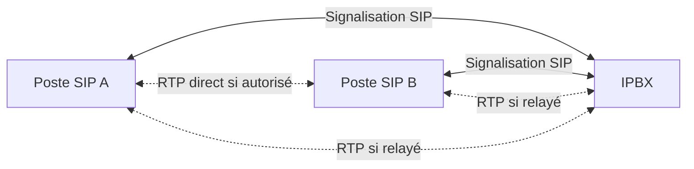

# Téléphonie sur IP — Déploiement et sécurisation d’un IPBX

**Projet académique — BUT Réseaux & Télécommunications.**

Ce projet porte sur le déploiement et la sécurisation d’un IPBX, la configuration du plan d’adressage, des services de téléphonie et des postes clients, puis les tests et l’analyse des communications.

Il s’agit d’un projet académique indépendant de tout homelab.

## Périmètre et portée de la documentation

Les réalisations attestées sont :

- Déploiement et sécurisation d’un IPBX.
- Configuration du plan d’adressage.
- Configuration des services de téléphonie.
- Configuration des postes clients.
- Tests des communications et analyse des communications.

Le produit IPBX, sa version, les modèles de postes, les codecs, les numéros et les configurations originales ne sont pas précisés. **Le schéma, les procédures, les adresses et les méthodes d’analyse ci-dessous sont des exemples documentaires : ils ne décrivent pas nécessairement les valeurs exactes ou les options effectivement utilisées.** Aucune solution particulière telle qu’Asterisk ou FreePBX n’est revendiquée. Wireshark est présenté comme un outil d’analyse possible, sans attester son utilisation historique dans ce projet.

## Objectifs

- Comprendre les rôles de l’IPBX et des postes dans une communication VoIP.
- Préparer un adressage cohérent et configurer les services de téléphonie.
- Vérifier l’enregistrement des postes et les communications.
- Distinguer les problèmes de signalisation des problèmes de transport audio.
- Intégrer la sécurisation à l’administration du service de téléphonie.

## Architecture logique illustrative

Le nombre de postes et le chemin des médias sont illustratifs. Selon la configuration, le RTP transite par l’IPBX ou circule directement entre postes.



### Plan d’adressage d’exemple

Ces adresses privées sont fictives ; elles ne sont pas les adresses attestées du projet.

| Élément | Adresse d’exemple | Fonction |
| --- | --- | --- |
| Réseau VoIP | `10.30.30.0/24` | Segment des équipements de l’exemple |
| Passerelle | `10.30.30.1` | Accès aux autres sous-réseaux si nécessaire |
| IPBX | `10.30.30.10` | Services de téléphonie |
| Poste SIP A | `10.30.30.101` | Premier client de test |
| Poste SIP B | `10.30.30.102` | Second client de test |

Les extensions téléphoniques sont des identifiants logiques distincts des adresses IP. Aucun identifiant réel ni secret d’authentification n’est publié.

## SIP et RTP : deux rôles distincts

**SIP** gère la signalisation : l’enregistrement d’un poste auprès d’un registrar, l’établissement d’un appel, sa modification et sa terminaison. Le contenu SDP associé aux échanges peut annoncer les adresses, ports et codecs proposés pour les médias.

**RTP** transporte les médias en temps réel, notamment l’audio. Il utilise des ports négociés, souvent dans une plage configurée sur l’IPBX. Un poste enregistré et un appel établi ne garantissent pas que les flux audio circulent correctement.

SIP peut utiliser UDP, TCP ou TLS selon les équipements. Le chiffrement de la signalisation avec TLS ne chiffre pas automatiquement l’audio : SRTP concerne les médias. Leur activation dans ce projet n’est pas attestée.

## Étapes générales de déploiement

Trame documentaire à adapter au produit retenu :

1. Définir le plan d’adressage, les besoins de communication et les accès d’administration.
2. Préparer l’hôte de l’IPBX : réseau, résolution DNS si nécessaire, synchronisation horaire et ressources.
3. Installer l’IPBX puis contrôler les services disponibles et leur exposition réseau.
4. Configurer les services et le plan de numérotation nécessaires aux appels internes.
5. Créer les comptes des postes et leur attribuer des secrets distincts, conservés hors du dépôt.
6. Configurer les postes : adresse du serveur, identifiant, authentification, transport et paramètres audio compatibles.
7. Vérifier les enregistrements, puis tester les appels et l’audio dans les deux sens.
8. Examiner les journaux et les communications, corriger les écarts et refaire les tests concernés.

Cette procédure n’implique ni raccordement à un opérateur, ni appels externes, ni fonctions avancées non documentées.

## Vérifications réseau

Contrôler successivement le lien, l’adresse et le masque, l’unicité des adresses, les routes, la résolution de noms lorsqu’elle intervient, puis les ports et le filtrage.

Exemples Linux :

```bash
ip address
ip route
ping -c 4 10.30.30.10
# Sur l’hôte Linux de l’IPBX, si cette administration est disponible :
ss -lunt
```

Exemples Windows :

```powershell
ipconfig /all
ping 10.30.30.10
# Seulement si un service SIP TCP est réellement configuré sur ce port :
Test-NetConnection -ComputerName 10.30.30.10 -Port 5060
```

Les valeurs sont illustratives. `Test-NetConnection -Port` teste TCP, pas SIP sur UDP. Le port 5060 n’est pas une valeur attestée du projet. Un ping ou un test de port ne valide ni les comptes SIP ni les flux RTP.

## Tests des communications

Les tests sont attestés, mais aucun compte rendu détaillé n’est disponible. Les critères suivants constituent une grille documentaire sans résultat revendiqué :

| Test proposé | Critère à examiner |
| --- | --- |
| Enregistrement de chaque poste | État enregistré et durée de validité cohérente |
| Appel de A vers B | Sonnerie, réponse, audio bidirectionnel et libération correcte |
| Appel de B vers A | Même validation dans le sens inverse |
| Appel vers une extension de test inexistante | Réponse cohérente et absence de routage indésirable |
| Nouvelle communication après une correction | Disparition du symptôme initial sans régression observée |

Ne pas tester des numéros publics, surtaxés ou d’urgence. Les communications de test doivent rester dans le périmètre autorisé du laboratoire.

## Analyse avec Wireshark — méthode documentaire

Capturer uniquement le trafic autorisé au point adapté : poste, interface de l’IPBX ou dispositif de capture prévu. Rechercher les échanges SIP, suivre l’établissement de l’appel, puis vérifier les flux médias annoncés.

| Filtre d’affichage | Utilité |
| --- | --- |
| `sip` | Signalisation SIP décodée |
| `sip.Method == "REGISTER"` | Requêtes d’enregistrement |
| `sip.Method == "INVITE"` | Requêtes d’établissement de session |
| `sdp` | Paramètres de session annoncés |
| `rtp` | Paquets reconnus comme RTP |
| `rtcp` | Rapports de contrôle des médias lorsqu’ils sont présents |
| `ip.addr == 10.30.30.10` | Échanges avec l’IPBX fictif de l’exemple |

Utiliser **Telephony → VoIP Calls** ou **SIP Flows** pour suivre la signalisation, puis **RTP Streams / Stream Analysis** pour examiner les flux, la gigue et les pertes observées. Un filtre RTP vide peut signifier que le flux n’est pas décodé, n’est pas capturé ou est chiffré ; il ne démontre pas à lui seul une absence d’audio.

Lors d’une authentification SIP, une réponse `401` ou `407` peut être un défi normal suivi d’une nouvelle requête authentifiée. Interpréter la séquence complète. Pour les médias, comparer les adresses et ports annoncés avec les paquets réellement observés. La capture et son emplacement peuvent eux-mêmes expliquer des paquets manquants.

Les captures SIP peuvent exposer des numéros, des identifiants et des éléments d’authentification ; les médias peuvent contenir de la voix. Aucun fichier de capture ou enregistrement réel n’est fourni ici.

## Sécurisation de l’IPBX

La sécurisation de l’IPBX fait partie du périmètre attesté. **Les mesures exactes n’étant pas documentées, la liste ci-dessous décrit des points de contrôle recommandés et non des protections dont l’activation est revendiquée.**

- Restreindre les interfaces d’administration aux sources autorisées et séparer les accès d’administration des usages courants.
- Employer des secrets robustes et distincts pour l’administration et chaque poste ; supprimer les identifiants par défaut.
- Limiter les ports exposés aux transports SIP, à la plage RTP et aux services réellement nécessaires.
- Appliquer les mises à jour compatibles et désactiver les comptes ou fonctions inutilisés.
- Limiter les destinations et droits d’appel ; surveiller les tentatives d’authentification et les comportements inhabituels.
- Évaluer TLS et SRTP selon les capacités des équipements, avec validation correcte des certificats.
- Protéger les sauvegardes et les journaux : ils peuvent contenir des secrets ou des données de communication.

Le filtrage doit tenir compte du chemin réel des médias. Une règle autorisant la signalisation seule ne suffit pas à assurer l’audio.

## Diagnostic des communications

| Symptôme | Causes possibles | Vérifications prioritaires |
| --- | --- | --- |
| Client non enregistré | Mauvais serveur, identifiant incorrect, transport incompatible, filtrage | Adresse et résolution du serveur, état des services, séquence REGISTER et réponse finale, journaux de l’IPBX |
| Appel impossible | Poste destinataire indisponible, extension ou règle de numérotation incorrecte, rejet SIP | Enregistrements, numéro composé, séquence INVITE et code de réponse, plan de numérotation |
| Audio absent ou unidirectionnel | RTP bloqué, adresse SDP incorrecte, NAT ou chemin média inadéquat | Adresses et ports annoncés, présence de RTP dans les deux sens, routes et filtrage ; NAT seulement s’il intervient |
| Audio dégradé | Pertes, gigue, congestion, codec ou ressources inadaptés | Statistiques RTP, charge des liens et de l’hôte, négociation des codecs, comparaison des points de capture |

Isoler une hypothèse, appliquer une correction maîtrisée, puis refaire le même appel de test. Aucune mesure de qualité ni seuil atteint n’est revendiqué dans ce dépôt.

## Compétences démontrées

- Déployer et sécuriser un service de téléphonie sur IP.
- Concevoir et configurer un plan d’adressage.
- Configurer les services de téléphonie et les postes clients.
- Tester les communications et analyser les dysfonctionnements observés.

## Limites et confidentialité

Ce dépôt ne décrit pas une infrastructure de production. Il ne revendique ni opérateur SIP, ni haute disponibilité, ni chiffrement effectivement activé, ni niveau de qualité mesuré.

Aucun secret n’est publié : aucun mot de passe SIP, token, clé privée ou fichier de sauvegarde de l’IPBX. Aucune IP publique sensible, donnée personnelle, numéro réel, capture réelle ou voix enregistrée n’est inclus. Les seules adresses affichées sont des exemples privés fictifs.

## Références techniques

- [Wireshark — guide utilisateur](https://www.wireshark.org/docs/wsug_html/)
- [Wireshark — analyse des appels VoIP](https://www.wireshark.org/docs/wsug_html_chunked/ChTelVoipCalls.html)
- [Wireshark — filtres SIP](https://www.wireshark.org/docs/dfref/s/sip.html)
- [SIP — RFC 3261](https://www.rfc-editor.org/rfc/rfc3261)
- [RTP — RFC 3550](https://www.rfc-editor.org/rfc/rfc3550)
